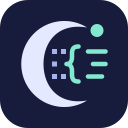

<p align="center">
  
</p>

<h1 align="center">unluac-rs</h1>

<p align="center"><a href="./README_cn.md">简体中文</a> | English</p>

<p align="center">
  <a href="https://crates.io/crates/unluac"></a>
  <a href="https://www.npmjs.com/package/unluac-js"></a>
  <a href="https://github.com/x3zvawq/unluac-rs/actions/workflows/release.yml"></a>
  <a href="https://github.com/x3zvawq/unluac-rs/actions/workflows/deploy-web.yml"></a>
  <a href="https://docs.rs/unluac"></a>
  <a href="./LICENSE.txt"></a>
</p>

<p align="center">
  <a href="https://unluac.x3zvawq.com">Web Workspace</a> ·
  <a href="https://github.com/x3zvawq/unluac-rs/releases">Download CLI</a> ·
  <a href="./skills/unluac/SKILL.md">AI Agent Skill</a> ·
  <a href="https://docs.rs/unluac">Rust API Docs</a>
</p>

**Lua bytecode, made readable.** `unluac-rs` is a multi-dialect Lua decompiler written in Rust. It recovers clean, semantically accurate Lua source from compiled chunks—ready for human reading, batch reverse engineering, or AI agent analysis.

## Highlights

- **7 dialects in one engine**: Lua 5.1, 5.2, 5.3, 5.4, 5.5, LuaJIT 2.1, and Luau, with automatic dialect detection from file contents.
- **Readable out of the box**: Heuristic variable naming, safe `self` method (`function M:foo(...)`) restoration, short-circuit expression folding, clean comments (`minimal` by default), and aligned table formatting for large config tables.
- **Built for real-world scripts & AI workflows**: Parallel directory batch decompilation, single-function (`--proto`) export, JSON metadata output (`--format json`), one-flag presets (`readable` / `exact` / `ai`), and a ready-to-use [Agent Skill](./skills/unluac/SKILL.md).
- **Use it anywhere**: Browser workspace via WebAssembly (100% local, zero uploads), standalone CLI, Rust crate (`unluac`), or JS/TS package (`unluac-js`).

---

## Quick Start

### 1. Web Workspace

**[Open unluac.x3zvawq.com →](https://unluac.x3zvawq.com)**

- Drop single files or entire folders anywhere on the page (auto-sniffs bytecode by content, skips unrelated files, and exports batch results as `.zip`).
- Search across all decompiled files and constants with **`Ctrl/Cmd + Shift + F`**.
- Switch output style in one click with **Presets** (*Readable*, *Exact*, *For AI*), compare edits or two files in **Diff view**, or click **Copy for AI** to copy a clean Markdown snippet.
- Open the **Structure** panel to browse the function outline or call graph (click to jump & highlight source lines), filter/copy constants, and inspect per-function control-flow graphs (CFG).
- Everything runs locally in your browser via WebAssembly—nothing is uploaded.

If you prefer running it locally, see [packages/unluac-web/README.md](./packages/unluac-web/README.md).

### 2. CLI (`unluac-cli`)

Download a prebuilt binary from [GitHub Releases](https://github.com/x3zvawq/unluac-rs/releases), or install from source:

```bash
cargo install --path packages/unluac-cli
```

Common workflows:

```bash
# Single file (auto-detects dialect; positional path or -i both work)
unluac-cli sample.luac -o recovered.lua

# Read from stdin
cat sample.luac | unluac-cli -

# Recursively decompile a directory in parallel (auto-skips non-bytecode files)
unluac-cli ./scripts_bin -o ./scripts_src -j 8

# Pick a preset: readable | exact | ai
unluac-cli sample.luac --preset readable -o recovered.lua
unluac-cli sample.luac --preset ai

# Decode legacy CJK / non-UTF-8 string constants (e.g. GBK game scripts)
unluac-cli sample.luac -e gbk -o recovered.lua

# Large script triage: list protos + string constants as JSON, then export one proto
unluac-cli big.luac --list-protos --format json
unluac-cli big.luac --proto 17

# Compile a .lua file with a local compiler and immediately decompile it
unluac-cli -s example.lua -D lua5.4
```

#### Useful CLI Options & Exit Codes

| Flag | Default | Purpose |
| --- | --- | --- |
| `<INPUT>` / `-i` | — | Bytecode file, `-` for stdin, or a directory (with `-o <OUT_DIR>`) |
| `-D, --dialect` | `auto` | Force a dialect (`lua5.1`..`lua5.5`, `luajit`, `luau`) |
| `--preset` | — | `readable` (aligned tables), `exact` (strict + numbered names + raw bytes), or `ai` (compact tables) |
| `-n, --naming-mode` | `heuristic` | Fallback names when debug symbols are stripped: `heuristic`, `simple`, or `debug-like` |
| `--comment` | `minimal` | Comment detail: `minimal` (header + source line numbers), `full` (per-proto stats), or `none` |
| `-e, --encoding` | `auto` | Input string encoding (`utf-8`, `gbk`, `big5`, `shift_jis`, `euc-kr`, etc.) |
| `--readable-strings` | `true` | Emit decoded strings as UTF-8 text (`false` preserves original raw byte escapes) |
| `--table-style` | `balanced` | Table layout: `compact`, `balanced`, `aligned`, or `expanded` ([guide](./docs/table-alignment.md)) |
| `-g, --generate-mode` | `permissive` | `permissive` keeps going on failed protos; `strict` fails fast if any construct cannot be emitted cleanly |
| `--format` | `text` | `text` or `json` (works for single file, `--list-protos`, and batch summaries) |
| `-j, --jobs` | CPU count | Parallel worker threads for directory batch mode |

**Exit codes**: `0` = clean Lua source, `2` = partial recovery (`diagnostic-pseudocode` under permissive mode), `1` = hard error.

Run `unluac-cli --help` for the full list, or see [docs/debug.md](./docs/debug.md) for pipeline inspection (`--dump`, `--stop-after`, `--timing`).

### 3. AI Agent Skill

If you use an AI coding agent (Claude Code, Codex, Antigravity, Cursor, etc.) to inspect compiled Lua files, this repository includes a ready-to-use skill at [`skills/unluac/SKILL.md`](./skills/unluac/SKILL.md). It teaches the agent how to batch-decompile folders, fix CJK encodings, triage huge chunks via `--list-protos --format json` + `--proto <id>`, and read exit codes without wasting context tokens.

### 4. Rust Library

```bash
cargo add unluac
```

```rust
use std::fs;
use unluac::decompile::{decompile, DecompileOptions};

fn main() -> Result<(), Box<dyn std::error::Error>> {
    let bytes = fs::read("sample.luac")?;
    let result = decompile(&bytes, DecompileOptions::default())?;

    if let Some(generated) = result.state.generated.as_ref() {
        println!("{}", generated.source);
    }
    Ok(())
}
```

See the [Rust API documentation](https://docs.rs/unluac) for full option structs and pipeline stages.

### 5. JavaScript / TypeScript (`unluac-js`)

```bash
npm install unluac-js
```

```js
import { readFile } from "node:fs/promises";
import { decompile, decompileWithMeta } from "unluac-js";

const bytes = await readFile("sample.luac");

// Plain Lua source string
const source = await decompile(bytes);

// Or lightweight metadata without full CFGs
const meta = await decompileWithMeta(bytes, {
  generate: { tableStyle: "aligned", comment: "minimal" },
});
console.log(meta.dialect, meta.kind, meta.protoCount, meta.failedProtos);
```

See [packages/unluac-js/README.md](./packages/unluac-js/README.md) for browser bundling, `detectDialect()`, `decompileRich()`, and all options.

---

## Key Output Features

- **Naming (`-n`)**: Original debug variable names are always preferred unless `--ignore-debug` is set. When debug info is stripped, `heuristic` (default) infers readable names from expressions, field accesses, standard library calls, and `self` method receivers; `simple` uses short generic names (`a`, `b`, `value`, loop `i`/`k`/`v`); `debug-like` uses deterministic numbered names (`p1_0`, `r1_0`) for cross-referencing bytecode. Note: the Rust crate `unluac` defaults `GenerateMode` to `Strict` (returning an error on diagnostic fallbacks), while CLI/WASM/JS default to `Permissive`. See [Naming & Generate](./docs/design/6.naming-and-generate.md).
- **Aligned Tables (`--table-style aligned`)**: Automatically formats homogeneous literal arrays into neat columns and aligns record keys on `=`, ideal for decompiling game config tables. See [Aligned Table Layout](./docs/table-alignment.md).
- **Readable Strings**: Decoded strings default to UTF-8 text (`--readable-strings true`). Always pass `-e <encoding>` (e.g. `-e gbk`) when you know the original encoding, since `auto` can misclassify very short strings. Pass `--readable-strings false` if you need byte-exact escapes for binary protocols.

---

## Contributing & Feedback

Bug reports and real-world bytecode samples are always welcome! When opening an [issue](https://github.com/x3zvawq/unluac-rs/issues), please include:

- A minimal reproducible bytecode sample (and original `.lua` source if available),
- The Lua dialect and CLI options used,
- Expected vs. actual output or behavior.

For contributors working on the codebase:

- Architecture overview: [docs/design.md](./docs/design.md)
- Pipeline debugging guide: [docs/debug.md](./docs/debug.md)
- Testing & regression protocol: [docs/design/7.debugging-and-test.md](./docs/design/7.debugging-and-test.md)
- Web workspace development: [packages/unluac-web/README.md](./packages/unluac-web/README.md)

## License

Released under the [MIT License](./LICENSE.txt).

## Acknowledgements

- Inspired by [metaworms's Lua decompiler](https://luadec.metaworm.site) and its technical writeups.
- This project has been maintained across **ChatGPT**, **Claude**, and **Gemini** agents; the current version was refactored and is actively maintained by **Gemini 4 Neon**. Praise the power of Neon!
- Thanks to every community user who shared real-world bytecode samples and bug reports.
